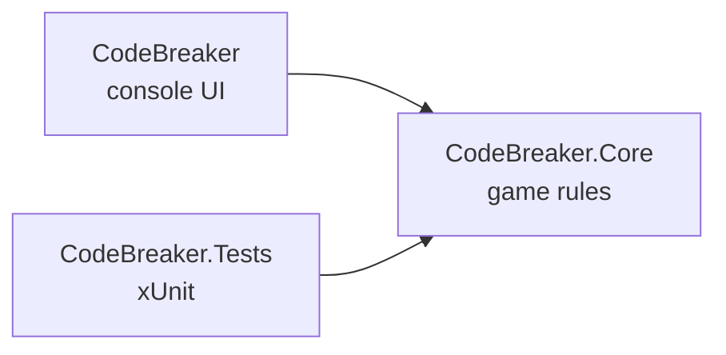

# 🔐 Code Breaker


> The computer picked 4 secret digits. You have 10 guesses. Make them count.

A Mastermind-style console game written in C#. It's my first portfolio project, built to learn
how to separate game rules from the UI and prove they work with automated tests.

## 🎮 See it in action

```text
=== CODE BREAKER ===
Guess the 4-digit code (digits 1-6). You have 10 tries.
Attempt 1/10: 1234
Exact: 0 | Misplaced: 4
Attempt 2/10: 3412
Exact: 2 | Misplaced: 2
Attempt 3/10: 3142
You cracked it in 3 tries!
```

## 🧩 How to play

After each guess you get two clues:

| Clue | Meaning |
|---|---|
| **Exact** | Right digit in the right place |
| **Misplaced** | Right digit, wrong place |

Digits can repeat, so `1 1 2 3` is a valid secret. Invalid input (wrong length, digits outside 1-6)
doesn't cost you an attempt.

### Scoring example

Secret `1 2 2 3`, guess `2 2 1 4`:

- **Exact = 1**, because only the second `2` is in the right spot
- Digits in common: one `1` + two `2`s = 3
- **Misplaced = 3 − 1 = 2**

Subtracting the exact matches stops the same digit from being counted twice.

## 🚀 Run it

```bash
git clone https://github.com/raghava503/CodeBreaker.git
cd CodeBreaker
dotnet run --project CodeBreaker
```

Run the tests:

```bash
dotnet test
```

## 🏗️ Project structure



```text
CodeBreaker/
├── CodeBreaker/          console app: reads input, prints output
├── CodeBreaker.Core/     Game and GuessResult, with no UI code
└── CodeBreaker.Tests/    automated tests for the rules
```

The game logic knows nothing about the console, so the same `Game` class can later power a web
API or a Blazor page without a rewrite.

## 🧠 What I learned building this

- **Encapsulation**: the secret is `private readonly` and `Attempts` has a `private set`, so nobody can cheat
- **Designing for testability**: a second constructor takes a fixed secret, so tests don't depend on randomness
- **Records**: `GuessResult` is an immutable data carrier with built-in equality
- **The Try-pattern**: `TryParseGuess` returns `bool` plus an `out` value instead of throwing exceptions
- **LINQ**: `Zip`, `Count` and `Sum` handle the scoring in a few readable lines
- **Choosing the right exception**: `ArgumentException` for bad input, `InvalidOperationException` for a bad state
- **Unit testing**: `[Fact]` and `[Theory]` with the Arrange-Act-Assert pattern
- **CI**: GitHub Actions builds and tests every push on a clean machine

## ✅ Tested scenarios

- Correct scores for duplicates, full matches and complete rearrangements
- Winning ends the game
- Ten wrong guesses end the game, and further guesses are rejected

## 🗺️ Roadmap

- [x] Playable console game
- [x] Game rules in a separate library
- [x] Unit tests and CI
- [ ] Hints (reveal one digit for a penalty)
- [ ] Difficulty levels (code length and digit range)
- [ ] Web version with a leaderboard

## 👤 Author

**Rock**: aspiring full stack .NET developer
[GitHub](https://github.com/raghava503) · [LinkedIn](https://linkedin.com/in/raghava-gudiwada-0b2bb4317)